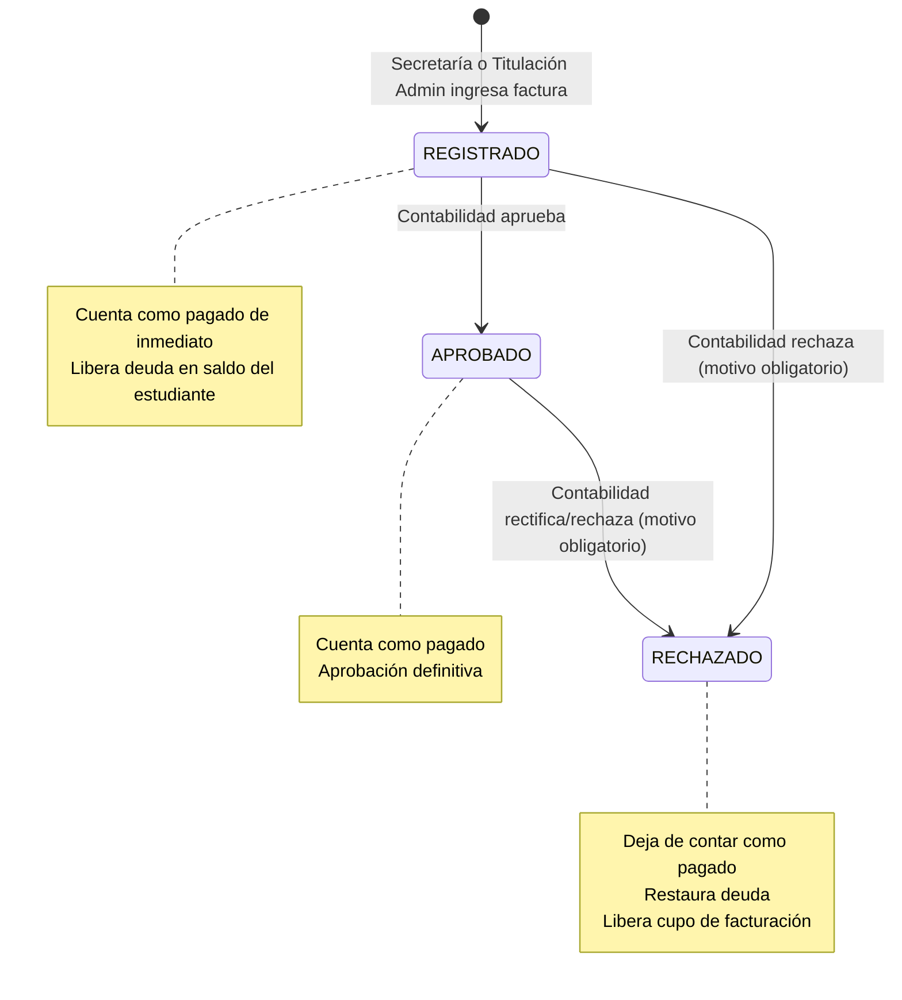

# Flujo de Pagos de Titulación por Modalidad con Topes Configurables y Aprobación de Contabilidad

## 1. Verificación del Estado Actual y Uso de Tablas Financieras

### 1.1. Diagnóstico de Tablas Core en `sigafi_es`
El sistema Titulación ISTPET opera sobre la base de datos institucional `sigafi_es`. La gestión financiera histórica se apoya en cuatro tablas principales:

1. **`credito_alumno`**:
   - **Propósito**: Mantiene la cuenta corriente/deuda generada para un alumno asociado a una matrícula (`idMatricula`) y una especie (`idEspecie`).
   - **Campos clave**:
     - `idCredito` (PK, INT): Identificador del registro de crédito.
     - `idMatricula` (FK, INT): Matrícula del estudiante en el periodo/carrera.
     - `idEspecie` (FK, INT): Concepto o arancel liquidado.
     - `creditoInicial` (DECIMAL(8,2)): Monto original adeudado o facturado.
     - `saldo` (DECIMAL(8,2)): Saldo pendiente por amortizar.
     - `migradoContabilidad` (TINYINT) y `fechaMigracion` (DATETIME): Banderas de conciliación contable por lotes de colecturía.

2. **`especies`**:
   - **Propósito**: Catálogo de conceptos arancelarios y derechos académicos del instituto.
   - **Campos clave**:
     - `idEspecie` (PK, INT): Identificador del rubro.
     - `especie` (VARCHAR(150)): Nombre legible (ej. "DERECHO DE GRADO Y TITULACION", "MATRICULA").
     - `valor` (DECIMAL(8,2)): Tarifa oficial del rubro.
     - `codigoReferencia` (VARCHAR(45)): Código presupuestario/contable.
     - `idperiodo` (VARCHAR(20)): Periodo de vigencia del arancel.

3. **`pagos`**:
   - **Propósito**: Encabezado del comprobante de caja, depósito o factura ingresada.
   - **Campos clave**:
     - `idPago` (PK, INT): Identificador único del pago.
     - `idMatricula` (INT, NULLABLE): Matrícula a la que se acredita el pago.
     - `factura` (VARCHAR(15)): Número de comprobante o factura.
     - `valor` (DECIMAL(8,2)): Monto total cancelado.
     - `fecha` (DATETIME): Fecha y hora del registro del comprobante.
     - `anulado` (TINYINT): Bandera booleana (1: Anulado, 0/NULL: Válido).
     - `fecha_anulacion` (DATE, NULLABLE): Fecha en la que el comprobante fue anulado.
     - `user_pago` (VARCHAR(20)): Identificador del cajero/usuario que registró el ingreso.

4. **`detalle_pagos`**:
   - **Propósito**: Detalle de amortización por especie del pago.
   - **Campos clave**:
     - `idPago` (PK/FK, INT): Referencia al comprobante en `pagos`.
     - `idEspecie` (PK/FK, INT): Especie cancelada.
     - `valor` (DECIMAL(8,2)): Subtotal imputado a dicha especie.
     - `idCredito` (FK, INT, NULLABLE): Referencia al crédito en `credito_alumno`.
     - `migradoContabilidad` (TINYINT) y `fechaMigracion` (DATETIME): Marcas de exportación a sistemas contables externos (SIGAFI desktop).

### 1.2. Ejemplos Sintéticos de Datos (Sin Información Real)

```sql
-- Especie institucional de titulación
INSERT INTO `especies` (`idEspecie`, `especie`, `valor`, `numeroCuotas`, `codigoReferencia`, `idperiodo`)
VALUES (501, 'DERECHO DE TITULACION ACADEMICA', 700.00, 1, 'TIT-700', '2026-S1');

-- Crédito generado al matricularse en titulación
INSERT INTO `credito_alumno` (`idCredito`, `idMatricula`, `idEspecie`, `creditoInicial`, `saldo`, `idDeudaApi`)
VALUES (9001, 1050, 501, 700.00, 700.00, 'DEUDA-TIT-1050');

-- Registro de pago de valor base
INSERT INTO `pagos` (`idPago`, `idMatricula`, `fecha`, `factura`, `valor`, `anulado`, `user_pago`)
VALUES (12001, 1050, '2026-11-06 10:00:00', 'FAC-001-00234', 500.00, 0, 'secretaria_usr');

-- Amortización del pago
INSERT INTO `detalle_pagos` (`idPago`, `idEspecie`, `valor`, `idCredito`, `migradoContabilidad`)
VALUES (12001, 501, 500.00, 9001, 0);

-- Actualización del saldo en credito_alumno
UPDATE `credito_alumno` SET `saldo` = 200.00 WHERE `idCredito` = 9001;
```

### 1.3. Consulta y Cálculo Actual de Saldos en el Código
En los servicios `ActoresService.cs`, `EgresadosService.cs` y `RepositorioPostulaciones.cs`:
1. El cálculo de saldos pendientes toma como base los registros de `credito_alumno` con `saldo > 0`.
2. Cruza con `detalle_pagos` y `pagos` filtrando estrictamente `where (p.anulado == null || p.anulado == false)`.
3. Todo comprobante con `anulado == 0` se deduce inmediatamente del saldo pendiente en la vista del alumno y en el expediente financiero de egresado.
4. **Hallazgo**: No existía hasta ahora un estado transaccional intermedio de aprobación contable en las tablas legacy de SIGAFI, ni vínculo entre las modalidades de titulación (`titul_modalidades`) y los topes de rubros ($700 base para complexivo vs $500 base + $200 inversión para propuesta tecnológica).

### 1.4. Interacción con Otros Sistemas y Seguridad de Escritura
- **SIGAFI Escritorio / Colecturía**: Lee `pagos` y `detalle_pagos` para reportes de recaudación y exporta mediante `migradoContabilidad`.
- **Estrategia de Seguridad**: Para evitar corromper la integridad de procesos existentes de SIGAFI y al mismo tiempo satisfacer los requerimientos de la titulación académica:
  1. Se implementan **tablas dedicadas del módulo `Tit_*`**:
     - `titul_configuracion_pagos_modalidad`: Topes parametrizables por modalidad ($700 total, base e inversión).
     - `titul_pagos`: Comprobantes de pago de titulación, con estado (`REGISTRADO`, `APROBADO`, `RECHAZADO`), auditoría y usuario revisor.
     - `titul_pagos_historial`: Historial de auditoría inmutable de transiciones de estado.
  2. Al registrar un pago en `titul_pagos`, este se enlaza con la postulación del alumno y se sincroniza opcionalmente con `pagos` y `detalle_pagos` con `anulado = 0`.
  3. Si Contabilidad **rechaza** el pago, se marca `titul_pagos.estado = 'RECHAZADO'` y `pagos.anulado = 1`. De este modo, los servicios legacy (`ActoresService`, `EgresadosService`, etc.) y las consultas del módulo de titulación dejan de considerarlo como pagado inmediatamente, restituyendo el saldo adeudado y liberando el cupo del tope de facturación.

---

## 2. Topes y Reglas por Modalidad

Toda titulación tiene un costo total institucional de **$700.00**. Los valores se configuran por modalidad sin estar fijos en código:

| Modalidad | Valor Base Máximo | Inversión Máxima (Materiales/Otros) | Total Titulación |
|---|---:|---:|---:|
| **Examen complexivo** | $700.00 | $0.00 | $700.00 |
| **Propuesta tecnológica** | $500.00 | hasta $200.00 | $700.00 |
| **Otras modalidades** | Configurable | Máximo $200.00 | $700.00 |

### Reglas de Validación de Valores:
1. `valorBase + maximoInversion == totalTitulacion` ($700.00).
2. `maximoInversion <= 200.00`.
3. Facturas de rubro `BASE`: No pueden superar `valorBase` de la modalidad ni el saldo disponible de base del estudiante.
4. Facturas de rubro `INVERSION`: No pueden superar `maximoInversion` de la modalidad ni el saldo disponible de inversión del estudiante.
5. Suma total de facturas activas (`REGISTRADO` + `APROBADO`) por estudiante: No puede superar `totalTitulacion` ($700.00).
6. Facturas rechazadas (`RECHAZADO`) o anuladas: No suman ni consumen cupo de los topes.
7. Unicidad de Factura: No se permite registrar el mismo número de factura dos veces.
8. Mensajes claros: Al exceder un tope, el backend informa el valor ingresado, el límite permitido y el saldo disponible.

---

## 3. Máquina de Estados del Pago y Roles RBAC



### Matriz de Responsabilidades RBAC:
- **`TITULACION_ADMIN`**:
  - Puede parametrizar configuraciones de topes por modalidad.
  - Puede registrar facturas de valor base e inversión.
  - **No puede** aprobar ni rechazar pagos.
- **`SECRETARIA`**:
  - Puede registrar facturas de valor base e inversión de los estudiantes.
  - Puede consultar resúmenes financieros y comprobantes.
  - **No puede** aprobar ni rechazar pagos.
- **`CONTABILIDAD`**:
  - Tiene acceso exclusivo a la bandeja de pagos por revisar.
  - Es el **único rol autorizado** para aprobar o rechazar comprobantes de titulación.
  - Debe proveer obligatoriamente un motivo en caso de rechazo.
